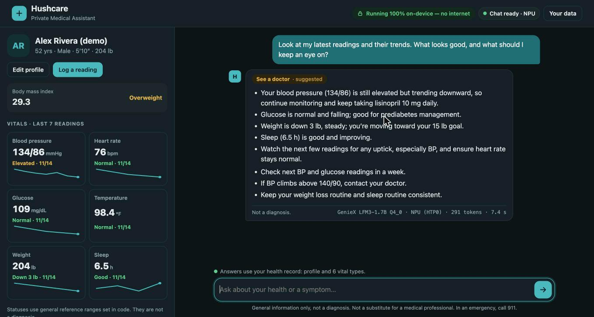

# Hushcare

**A private health assistant that lives on a small board on your desk and never phones home.**



## What it is

Hushcare is a health companion you can talk to. You keep a simple health record: who you are, your conditions, your medications, allergies, goals, and readings like blood pressure, glucose, weight and sleep. Then you ask questions in plain language: *How are my readings? Can I take ibuprofen with my blood pressure pill? What should I eat this week?* It answers like someone who has read your chart, citing your own numbers and your own goals.

The twist is where it runs. Everything — the language model, the app, and your data — runs on a Qualcomm Dragonwing IQ-9075 board. The model is LiquidAI's LFM3-1.7B, running on the board's Hexagon NPU. There is no cloud API behind it, no account, and no server somewhere else keeping a copy of what you typed.

## Why it's interesting

**Health data is the most private data most of us have.** Symptoms, diagnoses, prescriptions and mental-health worries are exactly the things people hesitate to type into a chatbot, because they don't know where it ends up. Hushcare's answer is simple: it doesn't go anywhere. The app makes no outbound network connections, and your record is a file on the board that only the device owner's account can read. One click deletes all of it.

**It keeps working without a connection.** A rural clinic, a cruise ship, a disaster shelter, a cabin with no signal: the places where a calm, knowledgeable second opinion matters most are often the places with the worst internet. Hushcare doesn't care. Answers take about three and a half seconds whether or not the outside world is reachable, and each question costs nothing.

**It actually knows you.** Most symptom checkers start from zero every time. Hushcare reads your saved record before every answer, so "is this worth worrying about?" gets answered in the context of *your* blood pressure trend, *your* medications and *your* goals.

**The dangerous decisions aren't left to the AI.** A small language model is great at explaining things and bad at being the last line of defense. So the parts that can hurt someone are plain code:

- **Emergencies are caught by rules, not the model.** If a message mentions chest pain, stroke signs, trouble breathing, severe bleeding, unconsciousness, a severe allergic reaction, or thoughts of suicide or self-harm, Hushcare shows a red "call 911" banner and a fixed, pre-written emergency reply. The model isn't consulted at all, so it can't talk anyone out of going to the ER. Self-harm messages get the 988 Suicide & Crisis Lifeline.
- **It won't tell you to change your medication.** If the model ever writes something like "stop taking your lisinopril", code replaces that line with "don't start, stop, skip or change any medication without talking to your doctor or pharmacist first."
- **Vital-sign statuses come from fixed reference ranges in code** (for example, blood pressure of 180/120 or higher is flagged "Very high"), not from the model's opinion.
- **Every answer is capped and checked.** Empty or broken replies are retried once and otherwise shown as an error, never as advice.

## What you can do with it

- Set up a health profile (or load the built-in demo person, *Alex Rivera (demo)*)
- Log readings: blood pressure, heart rate, glucose, temperature, weight, sleep. Each card shows the latest value, a status, and a trend line of the last seven readings
- Ask anything in a chat that remembers the conversation and your record
- See exactly what's stored, where, and with what permissions, and delete everything with two clicks

Hushcare gives general information only. It doesn't diagnose, and it is not a substitute for a medical professional. In an emergency, call 911.

## How it works

```
Browser (your laptop, over an SSH tunnel)
   │
   ▼
app.py on the board  ── 127.0.0.1:8000, Python standard library only
   │
   ├─ 1. Emergency rules (code) ──── match? → 911 banner + fixed reply, done
   │
   ├─ 2. Builds a prompt from your saved health record + the conversation
   │
   ├─ 3. LiquidAI LFM3-1.7B (Q4_0) via Qualcomm GenieX ── 127.0.0.1:18181, Hexagon NPU
   │      capped at 300 tokens, reasoning off, empty replies rejected
   │
   ├─ 4. Code checks the reply: urgency level, medication guard, disclaimer
   │
   └─ 5. Saves the exchange to a local file (owner-only permissions)
```

Both servers listen on loopback only. The web page is a single HTML file with inline CSS and JavaScript: no CDNs, no web fonts, no analytics.

## Measured on the board

Dragonwing IQ-9075 EVK, Ubuntu 24.04, GenieX v0.10.0 (bundled QAIRT 2.50), LFM3-1.7B Q4_0 on the NPU. The GenieX server log shows `Using 1 device(s): HTP0`.

| What | Result |
|---|---|
| End-to-end test suite (`e2e_test.py`) | 35 of 35 checks passed |
| Answer time, end to end | median 3.6 s over 10 requests (2.7–7.0 s) |
| Answer length | 120–290 tokens, 300-token cap |
| Emergency replies | instant, 0 model tokens (handled by code) |
| Model size on disk | 1001 MiB |
| Outbound connections from the app | none observed (`ss -tnp` during requests) |

These were measured with the board online. Memory use wasn't measured, and a full Wi-Fi-off rehearsal wasn't recorded.

## Run it

You need an IQ-9075 with the NPU packages installed (`qcom-fastrpc1`, `libqnn1`), your user in the `fastrpc` group, and GenieX v0.10.0 with the model cached:

```bash
geniex pull LiquidAI/LFM3-1.7B-GGUF:Q4_0
```

On the board, start the model server and then the app, each in its own terminal (or tmux window):

```bash
scripts/serve.sh run                 # GenieX on 127.0.0.1:18181, NPU, long keepalive
python3 app.py --no-vision           # Hushcare on 127.0.0.1:8000
```

On your laptop, open a tunnel and visit http://localhost:8000:

```bash
ssh -N -L 8000:127.0.0.1:8000 <user>@<board-address>
```

Click **Load demo profile** to get a realistic record to play with.

Useful options:

```bash
python3 app.py --self-test           # rule and parser checks, no model needed
python3 app.py --once "sore throat for two days"   # one question, JSON answer
python3 app.py --no-store            # don't save anything
python3 e2e_test.py --quick          # end-to-end checks against the running app
python3 e2e_test.py --clean          # ...and delete all stored data afterwards
```

Data lives in `~/.local/share/private-medical-assistant/` on the board: `profile.json`, `vitals.jsonl` and `records.jsonl`. The original single-form version of the app is still at `/classic`.

## Photos (experimental)

The code includes an optional photo route that sends a picture (say, of a rash) to ZETIC's LFM3-VL-2B package running on the same NPU through the Ixian Hexagon SDK. It worked in setup checks, but the board's Wi-Fi card crashed during the first real photo request. We haven't confirmed the photo request was the cause, so the demo runs with `--no-vision`, which hides every photo control.

## Honest limits

- The emergency rules are keyword based and deliberately cautious. "No chest pain" still triggers the banner. A false alarm costs a moment; a miss could cost a life.
- Stored data is protected by file permissions, not encryption.
- LFM3-1.7B is a small model. Its explanations are usually sensible but not always precise, which is exactly why the safety-critical parts live in code.
- The vital-sign ranges are general reference values, not personalized clinical targets.

## What's next

Encryption at rest, a clinician-reviewed red-flag list, LiquidAI's d1 decision model for triage in place of keywords, stable photo support, and voice input so you can just talk to it.

## Built at

The On-Device AI Hackathon *Cleared for Takeoff* (LiquidAI × Qualcomm Dragonwing), San Francisco, November 2026.

`scripts/serve.sh` comes from the hackathon's reference repository (MIT). Model weights are not included here; LiquidAI's LFM3 models are under the LFM Open License v1.0, and GenieX is distributed by Qualcomm under its own terms.

## License

MIT. See [LICENSE](LICENSE).
